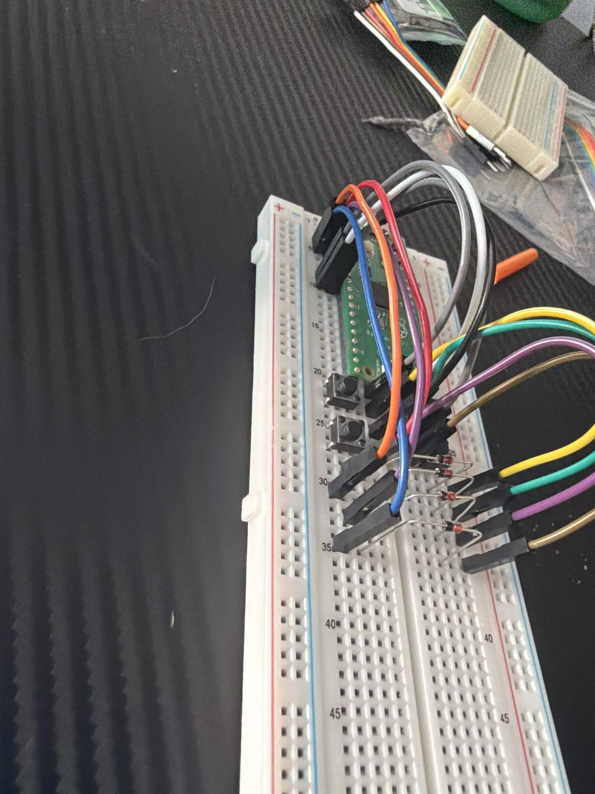

# Project Process and Testing

## Setup

- Installed VS Code and the Raspberry Pi Pico extension.
- Used Pico SDK 2.3.1 with the board target set to Pico.
- Connected a Pico H using a USB data cable.
- Designed the macro pad in KiCad and ordered the PCB.
- Started breadboard tests while waiting for the PCB.

## Test 1: Blink

**Goal:** Check that I could compile a program, flash it, and change its behavior.

1. Created the blink example project.
2. Compiled the default project.
3. Held BOOTSEL while connecting the Pico. This exposes the RPI-RP2 drive for loading UF2 firmware.
4. Copied blink.uf2 to the drive.
5. The drive disconnected automatically and the onboard LED started flashing.
6. Unplugged the Pico, changed the delay, recompiled, and flashed it again.
7. Observed the changed blink timing.

The saved code uses 500 ms for both the on and off delays, making a full cycle about one second. The Raspberry Pi example's original copyright and license notice are kept in blink.c.

## Test 2: Button-Controlled LED

**Goal:** Read an input and use it to control the onboard LED.

Used one button, two jumper wires, and the Pico H. I checked the button contacts with a meter first. The selected contacts showed very low resistance when pressed and an open circuit when released.

- Connected GP6 (physical pin 9) to one button contact.
- Connected GND (physical pin 8) to the other contact.
- Used buttonLEDtest.c.
- Observed the LED on while pressed and off when released.

The internal pull-up keeps GP6 high when the button is open. Pressing connects the input to ground, making it read low. The ! operator reverses the reading so pressed is true when the button is down.

The pull-up is a resistor, so this does not directly short the 3.3 V supply to ground. The 1 ms loop delay is not a debounce algorithm.

## Test 3: Toggle Button

**Goal:** Change the LED state once for each new press.

Used the same wiring as Test 2. Added lightToggle to remember the LED state and previouslyPressed to remember the previous input reading.

Things I corrected while writing this:

- Used = to assign a value; == compares values.
- Moved remembered state variables outside the loop so they do not reset every iteration.
- Inverted the GPIO reading because the input is active-low.
- Checked for pressed now and not pressed previously.
- Updated previouslyPressed after checking the transition.

This is edge detection. A steady held button does not toggle on every loop iteration, but bouncing contacts can still cause extra transitions.

The source is saved in togglebuttonLEDtest. A repeatable hold/release test passed with expected results

## Test 4: 2x2 Matrix Scanner

**Goal:** Read four buttons using two row pins and two column pins.

| Signal | GPIO | Physical pin |
| --- | --- | --- |
| ROW0 | GP2 | 4 |
| ROW1 | GP3 | 5 |
| COL0 | GP6 | 9 |
| COL1 | GP7 | 10 |

SW1 and SW2 belong to ROW0. SW3 and SW4 belong to ROW1. SW1/SW3 share COL0, and SW2/SW4 share COL1.

Each button has a series diode with its band toward the row. Each path connects a column to a row rather than directly to a GND pin.

### How the scan works

1. Set the columns as inputs with pull-ups.
2. Set the rows as inputs with pulls disabled, and preload their output values low.
3. Make ROW0 an output so it drives low.
4. Wait 10 microseconds and read both columns.
5. Release ROW0 by making it an input again.
6. Repeat for ROW1.
7. Print the readings and wait 100 ms before the next scan.

An inactive row is high impedance; it does not drive high. The 10 microsecond delay allows settling and is not debounce filtering.

### USB output

I enabled USB standard output and disabled UART output in the generated blink project's CMakeLists.txt. The code calls stdio_init_all(), then printf() sends switch readings to a serial monitor.

### Problem and fix

At first, every switch printed 1 regardless of what I pressed. Since the code inverts the input readings, this meant the columns were being read as low.

I found a mistake in the button wiring and corrected it. After that, the scanner responded to the buttons. I have not recorded the exact misplaced contacts, so use the connection table as well as the photo when following the circuit.

## Test 5: 2×2 Matrix on the PCB

**Goal:** Verify the first four keys on the custom PCB using the same firmware that worked on the breadboard.

I soldered two 1×20 female headers for the Pico H, then populated the top-left 2×2 section with switches SW1, SW2, SW5, and SW6 and their matching diodes D1, D2, D5, and D6. I matched each diode’s band to the `K` marking on the PCB.

I plugged the Pico H into the headers and ran the existing 2×2 matrix test without changing the code. I used the Serial Monitor to check that the four soldered keys responded. The test prints `SW1` through `SW4`, which correspond to PCB positions `SW1`, `SW2`, `SW5`, and `SW6`.

**Result:** The 2×2 test passed on the custom PCB. This verified the soldered switch and diode paths and the Pico header connections used by those four keys.

## Test 6: Full 4×4 Matrix on the PCB

After the 2×2 PCB test passed, I soldered the remaining 12 switches and their diodes. I expanded my scanner to use four rows (GP2–GP5) and four columns (GP6–GP9). It drives one row low at a time, reads the four columns, and prints all 16 switch states over USB serial.

**Result:** The scanner worked on the fully assembled PCB. I also held multiple keys at once and saw their states reported together in the serial monitor.

## Test 7: USB Keyboard on the 16-Key PCB

I used the Pico SDK’s TinyUSB HID example as the starting point for USB communication and connected it to my 4×4 scanner. I mapped SW1 through SW16 to the A through P key codes. Each scan builds a keyboard report from the switches currently held, and releasing all switches sends an empty report.

**Result:** I tested all 16 keys individually on the assembled PCB. Each key typed its assigned letter in Notepad.

### Tests recorded and Passed

- No buttons pressed: all zeros.
- Each button alone: only its own value is 1.
- Two buttons sharing a row.
- Two buttons sharing a column.
- Two diagonal buttons.
- Three buttons: the fourth stays 0.
- All four pressed, then released: all ones, then all zeros.

I made sure to hold the buttons long enough for the current 100 ms scan interval to catch them.

## Source Notes

The blink program is a Raspberry Pi example. The initial button-to-LED code was supplied during tutoring; I used it to learn GPIO setup and active-low inputs. I worked through the toggle and matrix code with explanations and review. These notes track what I understand, what I changed, and what still needs testing.
The example dev_HID_composite is a RaspberryPiExample. I used it as a starting point for a USB keyboard connection, i then connected my 4x4 matrix scanner to it and set the sw#Pressed variables to keys and checked over the array using a for loop.
