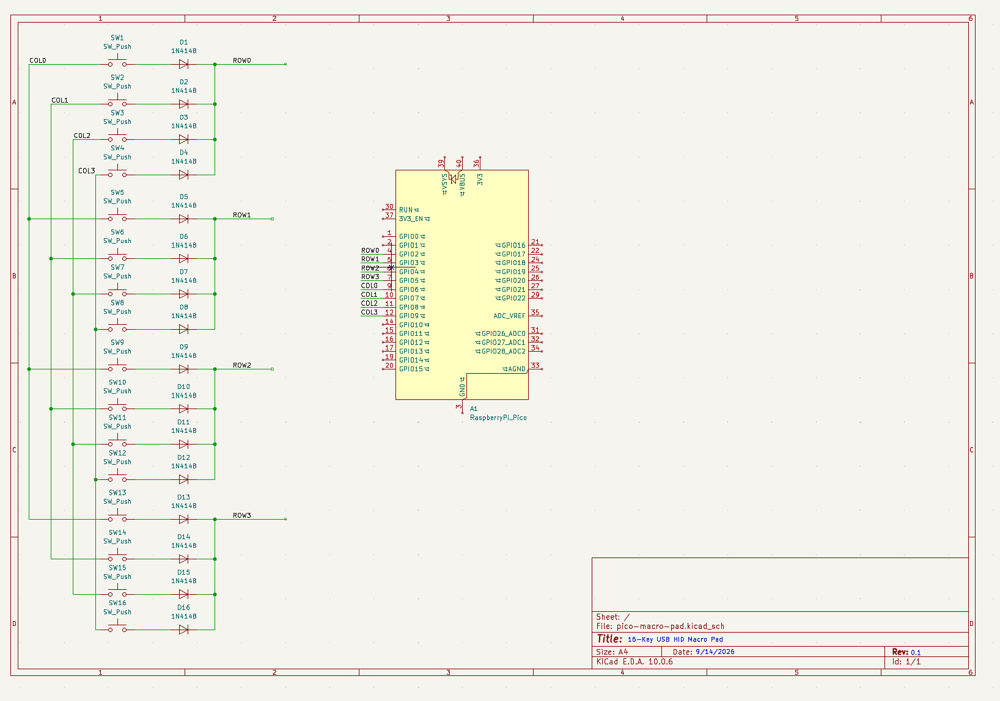
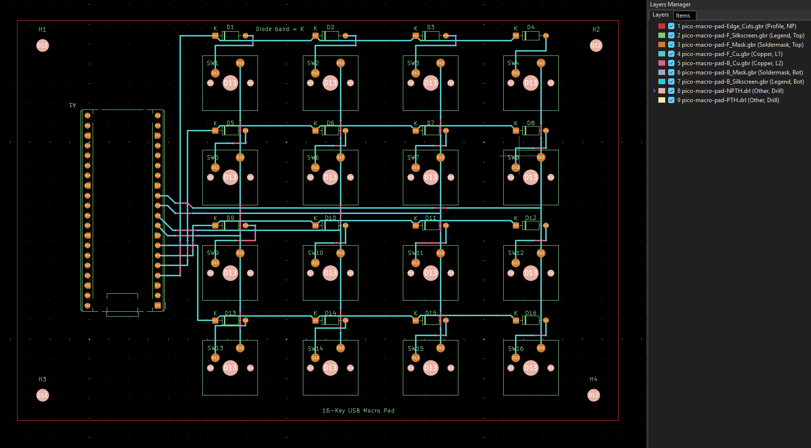

# PCB Design Documentation

**Project:** 16-Key USB Macro Pad  
**Design tool:** KiCad 10.0  
**Hardware revision:** First prototype  
**Status:** PCB ordered; assembly and full-board validation not yet documented

## 1. Design Objective

The objective was to design a custom PCB for a 16-key USB macro pad that could be assembled by hand and programmed in C. The board uses a Raspberry Pi Pico H as a removable controller and a 4x4 matrix of mechanical switches.

This first revision prioritizes accessible solder joints, straightforward routing, and clear component identification. Firmware is being developed and tested separately on a breadboard while the PCB is manufactured.

The design requirements were:

- Sixteen individually identifiable keys using eight GPIO signals.
- A diode at each key to isolate matrix paths during simultaneous presses.
- Through-hole assembly for switches, diodes, and controller sockets.
- USB connection and programming through the Pico's existing connector.
- Mounting holes for later mechanical support.
- A two-layer PCB suitable for prototype manufacturing.

## 2. Parts and Selection Rationale

| Part | Quantity | Selection and purpose |
| --- | --- | --- |
| Raspberry Pi Pico H | 1 | RP2040-based controller with USB support and preinstalled headers. Using a complete module avoids soldering a bare microcontroller and designing its supporting power, clock, flash, and USB circuits on this PCB. |
| Straight female headers, 1x20, 2.54 mm pitch | 2 | Accept the Pico H's existing male headers. The controller can be removed for replacement or breadboard testing without desoldering it. |
| Three-pin MX-style brown mechanical switches | 16 | Electrical contact switches compatible with the intended matrix circuit. Selected from an inexpensive available set. Their exact mechanical fit still needs confirmation against the physical parts. |
| 1N4148 axial switching diodes | 16 | One per switch to block reverse paths that can otherwise produce ghost keys. The through-hole package is accessible for hand soldering, and its band identifies the cathode. |
| Custom two-layer FR-4 PCB | 1 per assembly | Supports the parts and replaces breadboard wiring with permanent copper connections. Two copper layers allow independent nets to cross on different layers. |
| M3 mounting positions with 3.2 mm holes | 4 | Allow the board to attach to standoffs or a future base. Screws and standoff lengths depend on the final mechanical assembly. |
| Compatible keycaps | 16 | Provide the key surfaces and labels; these are mechanical accessories rather than electrical components. |

### Controller and socket choice

I selected the Pico H for its ready-to-use headers and the ability to develop firmware before the custom PCB arrived. The female sockets add height and occupy more space than a directly mounted controller, but make the prototype easier to assemble and service.

USB data and power enter through the Pico. The custom board therefore does not require a separate USB connector or USB data-pair routing. The matrix uses the Pico's internal column pull-up resistors, so external pull-up resistors are not included.

### Switch choice

The switches originally available from an older keyboard were optical types without electrical contact pins. They require a compatible optical sensing system and could not be used as simple switch contacts in this design.

The replacement three-pin switches have two electrical pins and a central plastic locating post. They can be soldered into compatible PCB holes, but lack the two additional locating posts of five-pin switches. A support plate remains a mechanical consideration for my finished assembly. Electrical compatibility alone does not establish adequate support.

## 3. Matrix Schematic



*Figure 1. Schematic development view. This image predates the final cleanup of unused pins and wire endpoints and should not be treated as the final manufacturing schematic.*

Each key consists of a normally open switch and a series diode. Four column nets and four row nets identify all 16 positions, reducing the GPIO requirement from 16 individual inputs to eight matrix signals.

The electrical path for each key is:

```text
Column -> switch -> diode anode (A) -> diode cathode (K) -> row
```

The cathode is the banded end of the physical diode. All cathodes connect toward their corresponding row.

During scanning, column inputs are pulled high internally. Firmware drives one row low and reads the columns. Pressing a key on the selected row creates a conducting path through its diode to the low row, causing its column to read low. The row is then released before the next row is selected.

Per-key diodes prevent unwanted reverse conduction through other closed switches. They do not debounce contacts or determine the number of simultaneous keys that a future USB report can represent; those remain firmware responsibilities.

### GPIO assignment

| Net | Pico GPIO | Physical header pin |
| --- | --- | --- |
| ROW0 | GP2 | 4 |
| ROW1 | GP3 | 5 |
| ROW2 | GP4 | 6 |
| ROW3 | GP5 | 7 |
| COL0 | GP6 | 9 |
| COL1 | GP7 | 10 |
| COL2 | GP8 | 11 |
| COL3 | GP9 | 12 |

The GPIO numbers used in C are different from physical header pin numbers. These eight GPIOs form a simple consecutive assignment that can be retained when expanding the breadboard scanner to the full board.

### Key numbering

| | COL0 | COL1 | COL2 | COL3 |
| --- | --- | --- | --- | --- |
| ROW0 | SW1 | SW2 | SW3 | SW4 |
| ROW1 | SW5 | SW6 | SW7 | SW8 |
| ROW2 | SW9 | SW10 | SW11 | SW12 |
| ROW3 | SW13 | SW14 | SW15 | SW16 |

Each switch has a matching diode reference: SW1 uses D1, continuing through SW16 and D16.

## 4. Footprint Assignment

| Component | KiCad footprint |
| --- | --- |
| Pico H socket interface | Module:RaspberryPi_Pico_Common_THT |
| Switches | Button_Switch_Keyboard:SW_Cherry_MX_1.00u_PCB |
| Diodes | Diode_THT:D_DO-35_SOD27_P7.62mm_Horizontal |
| Mounting holes | MountingHole:MountingHole_3.2mm_M3 |

The Pico footprint provides through-hole positions for the two header rows. Female sockets are installed at those positions; they are not an additional set of electrical connections.

The switch footprint includes holes for the additional locating posts used by five-pin switches. Those holes remain unused with the selected three-pin parts. The footprint name does not guarantee that every MX-style clone fits, so physical pin spacing and body clearance should be checked before assembly.

The diode footprint places axial leads 7.62 mm apart. Pad 1 is the cathode and pad 2 is the anode. In this design, switch pad 2 connects to diode pad 2, while diode pad 1 connects to the row. Polarity must be checked from the pad/net names, not simply the direction the footprint faces.

## 5. Component Placement and Board Outline


*Figure 2. Placement stage before routing. Thin connection lines are the ratsnest, not manufactured copper traces. The Pico was subsequently rotated 180 degrees in the board plane, and the mounting-hole references were changed from REF** to H1-H4.*

The switches were arranged in a four-by-four grid with consistent spacing. Diodes were placed near their corresponding switches to keep each local connection easy to identify. The Pico occupies the left side of the board, separate from the key area.

The board boundary was defined on Edge.Cuts, and four mounting holes were placed near the corners. Silkscreen identifies switches, diodes, mounting holes, and the board. The note "Diode band = K" records the assembly orientation.

The manufacturer upload detected a board size of 152.4 x 101.6 mm (6 x 4 inches). This first revision favors open spacing over a compact enclosure. Exact switch pitch should be taken from the editable PCB when designing a matching plate; a screenshot is not a dimensioned drawing.

The final Pico orientation places its USB connector toward the lower edge in the top-view layout. The connector remains inside the main board outline, so a future enclosure must leave access for the plug, cable, and BOOTSEL button.

## 6. Copper Routing and Design Checks

The matrix was routed using front and back copper. Connections on different copper layers can cross without joining; vias provide intentional layer changes. Plated through-hole component pads also connect copper between layers.

Routing connected each switch to its own diode, joined diode cathodes by row, joined the other switch contacts by column, and connected all eight matrix signals to the Pico.

During schematic checking, dangling wire endpoints were corrected. Later PCB-to-schematic checking identified duplicate REF** references and extra mounting-hole footprints. The later views show unique H1-H4 references. These mechanical items need to be represented or explicitly treated as board-only items in the final project.

Zero errors and warnings were reported during the design workflow, and a PCB check showed zero unconnected items. Some earlier screenshots also showed ignored test categories and a parity check that had not yet run. These results should therefore be recorded with their enabled checks rather than treated as proof of complete electrical and mechanical correctness.

The editable KiCad files and exported rule-check reports are not currently in this folder. Exact trace widths, clearances, via dimensions, and final check settings cannot be reconstructed reliably from the screenshots. Preserve these with the released design for reproducibility.

## 7. 3D Review


*Figure 3. KiCad rendering used to review overall placement, orientation, and silkscreen.*

The view shows the board outline, Pico location, diode placement, and mounting positions. The switch bodies and female sockets are not represented in this rendering, so it is not a complete mechanical assembly model.

Missing switch models do not imply missing PCB footprints. However, the rendering cannot establish keycap clearance, plate fit, socket height, or the final enclosure dimensions.

## 8. Manufacturing Outputs



*Figure 4. Exported manufacturing layers viewed together with plated and non-plated drill data.*

The manufacturing package contains the following seven Gerber layers:

| Layer | Purpose |
| --- | --- |
| F.Cu and B.Cu | Front and back copper |
| F.Mask and B.Mask | Front and back solder-mask openings |
| F.Silkscreen and B.Silkscreen | Front and back printed markings |
| Edge.Cuts | Board outline |

Both drill files are required:

- PTH.drl: plated holes for electrical component leads and vias.
- NPTH.drl: non-plated holes for mechanical features such as mounting screws and switch locating posts.

These files describe different hole types and are not duplicates. Drill-tool labels displayed in Gerber Viewer are viewer annotations, not extra component references printed on the PCB.

The Gerbers and both drill files were packaged into a ZIP and uploaded to JLCPCB. The upload recognized a two-layer board and displayed front and back previews.

### Recorded order selections

The order-screen capture reviewed before purchase showed these selections:

| Setting | Selection |
| --- | --- |
| Base material | FR-4 |
| Layers | 2 |
| Board thickness | 1.6 mm |
| Outer copper weight | 1 oz |
| Quantity | 5 single PCBs |
| Solder mask / silkscreen | Green / white |
| Surface finish | HASL with lead |
| Via covering | Tented |
| Electrical test | Flying-probe test |

FR-4 and a two-layer stackup provide a conventional prototype construction. The selected thickness provides a practical starting point for the hand-assembled board, while 1 oz copper is sufficient for the low-current matrix signals. HASL provides a solderable finish for the through-hole assembly.

These settings record the reviewed order screen; the manufacturer's final order confirmation should be retained as the authoritative purchase record. Manufacturing electrical testing does not replace functional testing with the Pico and firmware.

## 9. Assembly and Validation Plan

The PCB has been ordered, but this document does not claim successful assembly or 16-key operation. The working 2x2 breadboard scanner provides an initial test of the scanning method.

## 10. Design Records

The four images in this document record schematic development, component placement, 3D review, and manufacturing output inspection. They show different points in the workflow rather than four views of one identical saved revision.

See [processDocumentation.md](processDocumentation.md) for the firmware experiments and breadboard debugging notes.
