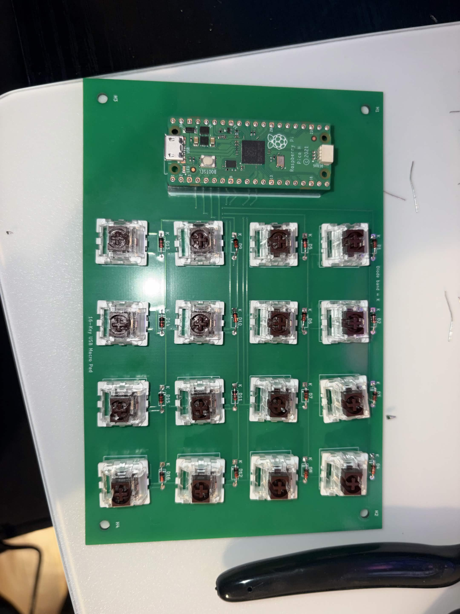

# 16-Key USB Macro Pad

I designed a custom 4×4 keypad in KiCad, soldered the board by hand, and wrote the matrix scanner in C for a Raspberry Pi Pico H. The assembled board works as a USB keyboard. I tested all 16 switches in Notepad, where SW1 through SW16 type `a` through `p`.

## How I built and tested it

1. Started with LED and button tests to learn GPIO and active-low inputs.
2. Built a 2×2 breadboard matrix and used USB serial to check switch states.
3. Soldered the Pico sockets and four switch-and-diode pairs onto the PCB. I ran the same 2×2 firmware to check the soldered connections before populating the rest.
4. Expanded the scanner to 4×4 and verified individual and simultaneous presses over serial.
5. Connected my scanner to the Pico SDK's TinyUSB HID example and verified each letter over USB.

The matrix uses four row GPIOs and four column GPIOs for 16 switches. The scanner drives one row low at a time and reads the four columns. Each switch has a 1N4148 diode to prevent unwanted current paths when several keys are held.

## Project files

- [PCB design notes](PCBDesignDocumentation.md) cover parts, schematic, layout, and fabrication.
- [Firmware and test log](FirmwareDocumentation.md) covers the experiments from blink through USB HID.
- [4×4 serial scanner](4x4buttonmatrix.c) reports raw key states for hardware troubleshooting.
- [USB keyboard firmware](4x4matrixLetterMapped.c) maps the 16 switches to letter keys.

## Build notes

I used VS Code with the Raspberry Pi Pico extension and Pico SDK 2.3.1, targeting `pico` for the Pico H. The HID source uses the USB descriptors and build settings from the [Pico SDK HID example](https://github.com/raspberrypi/pico-examples/tree/master/usb/device/dev_hid_composite). This repository contains the C source snapshots. To build the keyboard, start with that example project and use `4x4matrixLetterMapped.c` as its `main.c`, keeping the example's USB configuration and descriptor files. Compile and copy the generated UF2 to the Pico's `RPI-RP2` drive in BOOTSEL mode.

## Next steps

Record simultaneous USB key presses and releases, check quick taps, and add per-key debouncing. The current key map is the keyboard demo. Shortcut macros are the next firmware milestone.

I wrote the scanner and key mapping while learning from Raspberry Pi's examples. I used Codex for tutoring and troubleshooting guidance.
